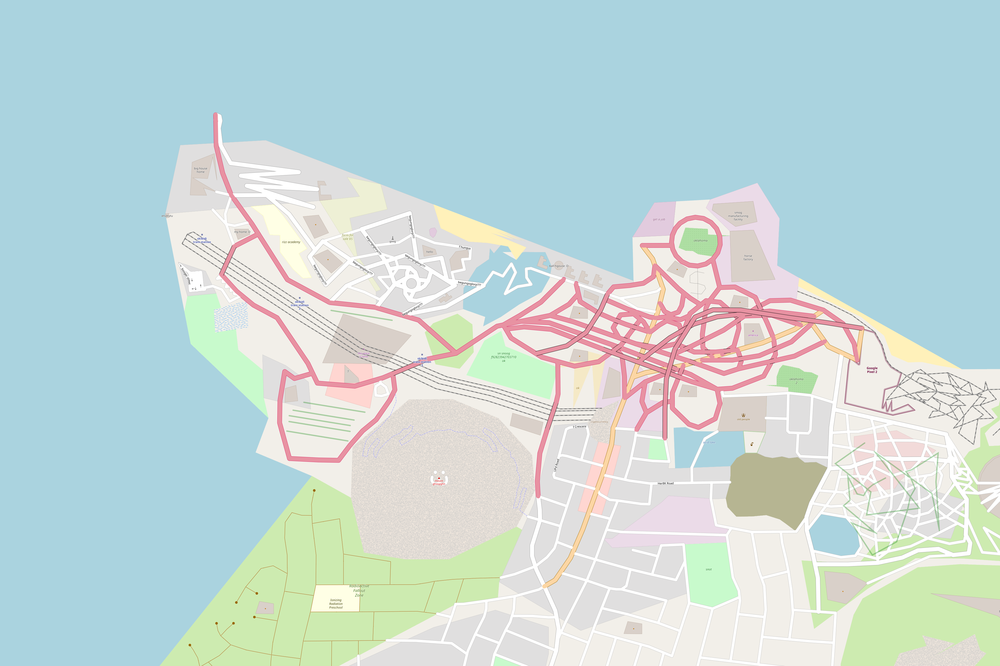

# ogfimg
OGF/OSM Image/tile downloader and stitcher

This is a simple tool I made with ChatGPT for downloading tiles on [OGF](https://opengeofiction.net), OSM or Arhet then stitching them to one pretty map.

## Setup

First install the following dependencies with:
`pip install flask requests pillow`

After that you should be able to just run the app.py then on port 5000 of the machine you put it on it should show the site ready to use.

## Usage
When on port:5000 of your local machine, you will enter the core page of OGFimg. The process is broken into 3 steps:
1. Config - You can choose one of the many map sources and the zoom level of the image
2. Area Selection - Defines the corners of the bounding box. Instead of adding values manually you can use the 'Draw a Rectangle" tool and drag over the area you want and it will add the values for you.
3. Download & Process - This gives you a preview of tile count and image size in pixels to help with getting the right map size and then downloading and stitching map buttons. A button to get your image will reveal once fully downloaded.

### Once Done
If you need more than one image to be created, refresh your page and you can start again. If you are finished with using the program just close the command prompt :)

## Examples

*Oban, Scotland (OPNVKARTE)*

*Roantra, West Uletha in OGF carto*

*KFC sponsored dicatatorship in Arhet-Carto*

*Linlithgow in Humanitarian style*

*Belfast city centre in OSM France style*
